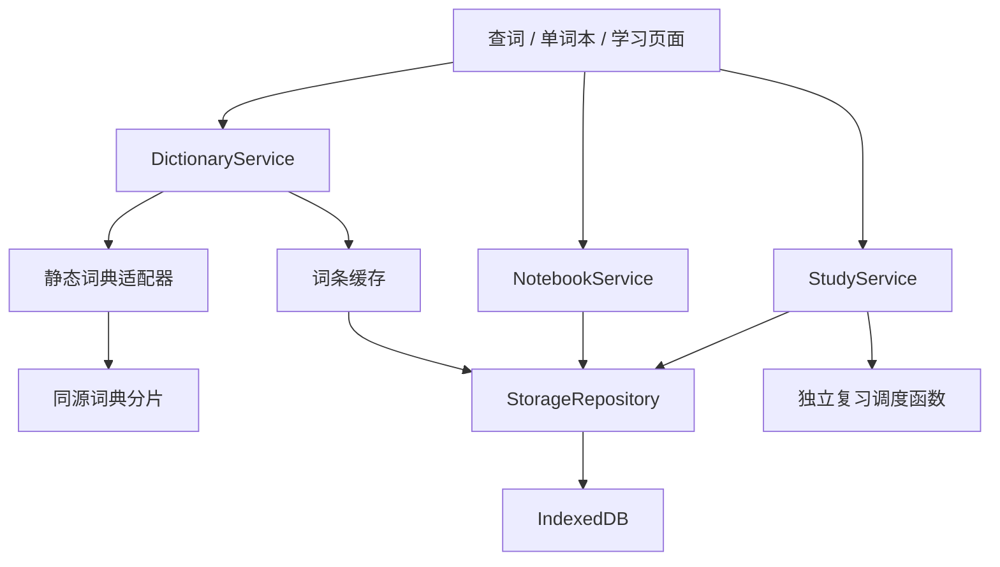

# 英文词典与单词本网站设计文档

版本：0.1（开发前设计）  
日期：2026-10-10（北京时间）  
工作目录：`C:\Users\Administrator\Desktop\words`  
前置调研：[GitHub 项目调研](./GITHUB_RESEARCH.md)

补充设计：[前端视觉与交互设计](./FRONTEND_DESIGN.md)。网页视觉、组件和动效以该文档的详细规范为准，功能与数据规则以本文为准。

## 1. 目标与核心决策

做一个日常英语学习网站，把查词自然转为积累和复习：

**输入英文单词 → 查看中英释义、多种含义和近义词 → 自动进入词本 → 整理分类 → 翻卡复习 / 拼写练习。**

用户已确认需要中英双语释义。第一版采用中文界面，面向个人使用，不要求注册；先开发并验证基础网页，实际部署在后续阶段完成。

建议采用 **React + TypeScript + Vite 的静态单页应用、静态词典分片、IndexedDB 本地数据存储**。现有项目作为交互和功能参考，独立实现本项目。构建产物可用于后续托管，不把功能绑定在开发机器上。

第一版双语展示为“中文释义汇总 + 英文多义项”，英文义项下展示对应近义词。ECDICT 与 WordNet 的义项没有天然对齐关系，因此第一版不承诺每条英文释义都附有逐条对应的中文翻译。

## 2. 第一版范围

| 模块 | 必须完成的行为 |
| --- | --- |
| 查词 | 输入并搜索英文单词；显示音标、中文释义、英文多义项、词性和按义项区分的近义词 |
| 自动记录 | 每次成功查词更新历史；首次成功查到的词自动加入“我的单词”；重复查询不创建重复词条 |
| 词本整理 | 创建、重命名词本，添加或移出词汇；一个词可属于多个词本；筛选、排序、添加笔记 |
| 学习 | 按选定词本翻卡回忆，自评“忘记 / 模糊 / 记住”，按规则安排复习 |
| 拼写 | 根据中文释义与可选英文提示输入单词，给出结果和正确拼写 |
| 数据保存 | 刷新后保留词本、笔记和进度；JSON 导出与合并导入 |
| 网页适配 | 桌面与手机可用，有空状态、加载状态、错误状态与基本键盘操作 |

第一版暂不加入账号、云同步、排行榜、社交分享、AI 自动生成内容、支付、完整离线安装和通知。音频可作为增强功能：优先使用可用词典音频，缺失时可尝试浏览器语音；音频不可用不阻塞查词和学习。

## 3. 页面与操作流程

导航只保留三个主要入口：**查词、单词本、学习**。数据备份和来源说明放在设置菜单。

### 3.1 查词页

桌面主栏展示搜索框和词条，侧栏展示最近查询及“今日待复习”。手机按单列展示，最近查询收起。

搜索结果排列：

1. 单词标题、音标、词本归属和学习状态。
2. 中文释义，保留来源中可靠的词性分组和多个含义。
3. 英文释义按词性、义项展示；每个义项附带其近义词及可用例句。
4. 笔记与“整理到词本”入口。
5. 数据来源和内容缺失说明。

近义词使用可点击标签；点击后发起一次明确查询，按普通查词规则记录。缺少近义词时显示“该含义暂无近义词”，不用其他含义或泛相关词填充。

例：查 `bank` 时，中文区域展示来源提供的多个释义；英文“金融机构”和“河岸”等义项分别列出，各自展示对应近义词。只有数据源证明关系的词才显示在该义项下。

### 3.2 单词本页

默认入口“我的单词”汇集所有已收录的词；用户可另建“工作英语”“阅读生词”等分类词本。默认词本不能删除或重命名。

每行显示：单词、中文简释、学习状态、最近查询时间、所属词本。支持按单词或笔记搜索，按新词/学习中/已熟悉/已暂停筛选，以及按最近查询、加入时间、字母顺序排序。

“整理到词本”使用多选归属；从分类词本移除只取消归属。“删除单词”从所有词本移除并删除其学习进度，显示影响数量并允许短时间撤销。删除分类词本保留词汇在“我的单词”中。

### 3.3 学习页

先选择词本、翻卡或拼写模式，以及“今日复习”或“自由练习”。默认选择“我的单词”的今日复习；每轮最多 20 个不同单词，优先到期词，再补最多 10 个新词。允许用户调整本轮数量。

翻卡正面展示英文单词与音标；背面展示中文释义、英文含义、近义词和个人笔记。可切换为中文提示、回忆英文单词。答案揭示后才能自评。

拼写模式先显示中文释义，可展开英文提示；输入后显示正确与否、正确拼写和完整词条。无可靠释义或纯音译专名不自动生成拼写题。

顶部显示本轮进度，结束后显示完成词数、自评结果或拼写正确率，以及下一次复习时间。退出或刷新后可以继续本轮。

### 3.4 搜索到学习的数据流程


## 4. 关键产品规则

### 4.1 查询、去重与自动入本

- 去掉首尾空格，统一 Unicode 和常见撇号，按不区分大小写的标准键查询；展示保留词库原始写法。
- 第一版主流程支持单词及词库收录的含连字符、撇号词；短语只在词库有精确记录时返回，不擅自拆成几个词。
- `Bank`、`bank`、` bank ` 对应同一条个人词汇记录。词形变体仅在数据源给出可靠原型关系时提示，不能仅靠截取词尾改写用户输入。
- 用户按 Enter、点搜索按钮或点近义词才算一次查询；输入变化、页面重绘、网络重试不算新的查询。
- 成功查询表示至少取得一项有效释义。记录查询次数、首次查询时间、最近查询时间；首次查询自动收录，提示“已加入我的单词”。
- 查无结果、输入无效和服务异常不创建可学习的词条。部分语言缺失的词可记录，但显示明确标记。
- 重复搜索更新计数和时间，保留原有笔记、分类、进度和暂停设置。
- 清除查询历史只清除历史记录和查询计数，不删除词本或复习进度。
- 用户暂停学习的词不进入计划队列，再次搜索也不会自动恢复。删除过的词若再次成功查询，会按新词重新收录。

### 4.2 多词本与学习状态

同一个词可进入多个词本，但只有一份个人笔记和一份学习进度。更换词本学习不会产生重复日程；合并多个词本时按词 ID 去重。

状态：`new` 新词、`learning` 学习中、`familiar` 已熟悉；另用 `paused` 控制是否参加学习。“已熟悉”仍可有未来复习日期。

第一版以单词为复习单位，背面可展开全部义项；不把一次自评解释为已掌握该词每一种含义。后续可以增加按义项独立学习。

## 5. 学习与复习设计

先使用明确、可解释的阶梯规则，不将其宣称为经过个性化优化的记忆算法。间隔表为 **1、3、7、14、30 天**，未来可替换为 FSRS 等算法。

每个词记录 `stage`（初始 -1，最高 4）与 `dueAt`。在“今日复习”中，每个词每轮最多提交一次计划评分：

| 评分 | 阶段变化 | 下次安排 |
| --- | --- | --- |
| 忘记 | `stage = -1`，状态改为学习中 | 当前时间 + 10 分钟；本轮尾部可再练一次，再练不重复推进日程 |
| 模糊 | `stage = max(-1, stage - 1)` | 明天同一当地时间；状态为学习中 |
| 记住 | `stage = min(4, stage + 1)` | 按新阶段取间隔表；进入阶段 3 及以上标记已熟悉 |

“自由练习”可练未到期的词，只记练习日志，不改变计划阶段与 `dueAt`。拼写错误在计划学习中记为“忘记”，首次正确记为“记住”；看过答案后的重试只记练习，不再次推进。

队列规则：

- 将 `dueAt <= now` 的未暂停词按最早到期排序，再补充未学习的新词。
- 开始本轮时固定词汇队列；中途查词不会突然改变本轮内容。
- 保存当前卡片、已提交事件和重练队列，恢复时避免重复计分。
- 无到期词时显示下次到期时间，仍可开始新词或自由练习。

所有时间保存为 UTC 时间戳；界面与“明天 / N 天后”的日历计算采用设置中的学习时区，默认浏览器时区。当前用户默认 Asia/Shanghai。跨午夜按当地日期统计，跨时区后保留已有绝对到期时间，新的评分按新设置计算。

统计口径：完成词数按当地当天不同词 ID 计数；复习事件另计次数；翻卡自评不显示为客观正确率，拼写练习才统计首次提交正确率。连续学习天数由日志中的当地日期推导。

## 6. 技术架构

| 层 | 第一版选择 | 用途 |
| --- | --- | --- |
| 页面 | React + TypeScript + Vite | 三个交互页面与静态构建 |
| 样式 | CSS 变量与组件样式 | 统一颜色、间距、响应式布局，避免引入庞大模板 |
| 路由 | Hash 路由 | `#/search`、`#/notebooks`、`#/study`；适配后续 GitHub Pages 等静态托管 |
| 页面状态 | React 状态和 Context | 查询状态、本轮学习状态、小规模共享状态 |
| 用户存储 | IndexedDB，使用 Dexie 封装 | 事务、索引、数据版本迁移 |
| 偏好设置 | localStorage | 主题、默认学习数量、时区等少量设置 |
| 词典 | ECDICT + WordNet 转换后的 JSON 分片 | 同源、按需读取的基础查词数据 |
| 校验 | TypeScript 与运行时数据校验 | 防止坏词条、无效导入文件进入状态 |

[IndexedDB](https://developer.mozilla.org/en-US/docs/Web/API/IndexedDB_API) 适合存储有索引的结构化数据，并支持事务；它仍属于浏览器中的本站数据，不能提供跨设备同步。



页面只依赖服务接口，不直接操作数据库或依赖外部 API 字段。后续可替换词典适配器和存储实现，保留页面与学习规则。

### 建议目录

```text
words/
  docs/                       调研与设计
  scripts/build-dictionary.*   数据清洗、词典转换和质量报告
  src/
    pages/                    Search、Notebooks、Study
    components/               SearchBox、WordEntry、Flashcard 等
    services/                 Dictionary、Notebook、Study
    storage/                  数据库、索引、迁移、导入导出
    dictionary/               规范化、分片定位、适配器
    study/                    队列与调度规则
    types/                    统一数据类型
    styles/                   视觉变量与响应式样式
  public/dictionary/          版本清单与词典分片
  public/licenses/            数据和复用代码的许可声明
  tests/                      关键数据规则与端到端流程
```

## 7. 词典处理与双语展示

### 7.1 数据处理

从 [ECDICT](https://github.com/skywind3000/ECDICT) 读取中文释义、已有英文释义、音标等字段；从 [WordNet](https://wordnet.princeton.edu/) 读取英文义项和对应近义词。实现时固定源版本和校验和，保存许可及来源记录。

构建脚本使用真正的 CSV 解析器处理引号、逗号和换行；读取 WordNet 的索引与数据文件。格式损坏的记录进入质量报告，不能悄悄错列。输出统计包括词条数量、缺中/英文数量、无近义词数量、重复键、格式异常和分片大小。

规范化时：

- 保留 ECDICT 中文原文和来源；仅识别明确词性标签，不凭标点猜义项。
- WordNet 义项使用带源版本的稳定 ID；近义词来自该义项的 synset，去掉当前词本身、统一展示并去重。
- ECDICT 英文与 WordNet 英文分清来源，不按数组下标合并。不确定的重复保留为来源明确的补充释义。
- 中文区域与英文义项分别展示。原始双语内容不对齐时不生成虚假的逐条翻译。
- 有些义项没有其他同义成员，应允许近义词为空；功能支持近义词不意味着每个词每个义项都有近义词。

### 7.2 静态分片

不将约 62.9 MiB 的原始 CSV 放进首屏脚本。按标准化词键的稳定哈希分桶，初始采用 512 个分片；manifest 记录哈希算法、桶数量、数据版本、文件映射、校验和与统计。

查询只定位并下载对应分片，将需要的词条存入 IndexedDB；分片可使用浏览器 HTTP 缓存。部署新词库时文件名含版本或内容哈希，避免新 manifest 读取旧分片。实际分片上限在转换后测量，目标为压缩后单片不超过 300 KiB，超出时调整桶数量并重新生成清单。

应用构建直接包含已生成的分片，日常构建不要求每次下载原始词库。资源路径使用 Vite 配置的基础路径，不硬编码域名或 `/dictionary` 根路径。

首次访问需要网络下载应用和对应分片；应用已打开时，已保存的词可以断网学习。完整离线启动需要另加 Service Worker，安排在后续阶段。

### 7.3 内容完整度与在线增强

基础词条优先使用同源数据。WordNet 缺词时保留 ECDICT 英文；英文或中文缺失时显示具体缺失状态，不用虚构内容补齐。

双语基础功能的验收必须使用经过核查、两种语言都有内容的常见词测试集。实现完成后报告实际覆盖率，不能仅凭数据源说明声称任意英文词都有完整双语结果。

[Free Dictionary API](https://dictionaryapi.dev/) 和 [Datamuse](https://www.datamuse.com/api/) 留作后续在线增强适配器。它们失败时不影响静态词条；Datamuse 的词级近义词结果不直接插入某个 WordNet 义项。涉及 API Key 的接口通过后续服务端代理，浏览器代码与公开环境变量中不放密钥。

## 8. 数据模型与一致性

以下为拟定的存储结构，不是当前已存在的数据库。

| 实体 | 主要字段 | 约束 / 索引 |
| --- | --- | --- |
| WordEntry | `id`、`word`、`normalizedWord`、`phonetics`、`chineseGlosses`、`englishSenses`、`sources`、`dataVersion`、`contentStatus` | `id = en:标准化词键`；词键唯一；每个英文义项含稳定 ID、词性、释义、近义词、来源 |
| PersonalWord | `wordId`、`addedAt`、`note`、`paused`、`updatedAt` | `wordId` 唯一；独立于词典缓存，刷新词典不能覆盖用户数据 |
| Notebook | `id`、`name`、`createdAt`、`updatedAt`、`isDefault` | 默认词本固定 ID；分类名称不区分大小写且不允许重复 |
| NotebookWord | `notebookId`、`wordId`、`addedAt` | 复合键唯一；“我的单词”为 PersonalWord 全集，不另存重复归属 |
| SearchEvent | `id`、`wordId`、`searchedAt` | 每次用户提交生成独立 actionId，作为事件 ID 唯一保存；网络重试复用同一 ID |
| SearchHistory | `wordId`、`firstSearchedAt`、`lastSearchedAt`、`searchCount` | `wordId` 唯一；按最近查询时间索引 |
| StudyProgress | `wordId`、`stage`、`status`、`dueAt`、`lastReviewedAt`、`reviewCount`、`lapseCount`、`schedulerVersion`、`updatedAt`、`version` | `wordId` 唯一；按 `dueAt`、状态索引；version 用于并发检查 |
| ReviewEvent | `id`、`sessionId`、`wordId`、`wordSnapshot`、`mode`、`rating`、`correct`、`reviewedAt`、`studyDate`、`timeZone`、`before`、`after` | 事件 ID 唯一；保留词名与必要展示快照，删除个人词汇后仍能解释历史统计 |
| StudySession | `id`、`notebookIds`、`mode`、`queue`、`cursor`、`retryQueue`、`submittedEventIds`、`startedAt` | 保存本轮快照与恢复位置；一次只恢复一个进行中的学习会话 |
| AppMeta | `schemaVersion`、`dictionaryVersion`、`preferences` | 数据迁移明确版本；备份包含版本与来源 |

查询成功后，以同一 IndexedDB 事务保存唯一 SearchEvent，再更新词条快照、个人词汇和历史聚合；事件已存在时不再次累加查询次数。清除历史同时清除查询事件。事务提交成功后才提示“已保存”；保存失败时仍可显示词条，但提示失败并提供重试。

计划评分以“本轮 + 单词 + 计划尝试”生成唯一事件 ID，在事务中同时写事件和进度；双击或跨标签页重复提交只生效一次。进度更新检查版本，检测到其他标签页已改动时重新读取。

### 服务接口草案

```text
DictionaryService.lookup(query) -> 规范化词条或明确错误
NotebookService.recordSuccessfulSearch(word, actionId) -> 已保存结果
NotebookService.create / rename / delete(notebook)
NotebookService.setMembership(wordId, notebookIds)
NotebookService.updateNote / pause / deleteWord(wordId)
StudyService.startSession(notebookIds, mode, limit)
StudyService.submitReview(sessionId, wordId, rating, eventId)
StudyService.resumeSession / finishSession(sessionId)
StorageRepository.exportBackup / importBackup(file)
```

API 风格只是模块边界，第一版不要求 HTTP 后端。错误类型区分 `INVALID_QUERY`、`NOT_FOUND`、`NETWORK_ERROR`、`DATA_ERROR`、`STORAGE_ERROR`。

## 9. 备份、迁移与边界情况

导出 JSON 包含 schemaVersion、导出时间、词条快照、个人词汇、词本关系、查询事件与历史、进度和复习事件。第一版只提供合并导入，避免误覆盖现有数据。

导入先校验文件大小（上限 20 MiB）、结构、字段长度、ID 与关联关系，展示新增词条、同词冲突和无效记录数量，再由用户点击“导入”。查询与复习事件按 ID 去重，查询聚合由合并后的查询事件重新计算；同词进度冲突保留更新时间更晚的快照并保留双方日志，不能直接相加学习次数。不同笔记保留两份并标记来源；词本 ID 冲突但名称不同时新建本地 ID，重映射归属；同名分类合并到同一个本。导入会话不自动恢复，避免混入正在学习的队列。全部写入使用事务，失败回滚。

| 情况 | 网页行为 |
| --- | --- |
| 空输入 / 超长输入 | 不发起查询，提示输入要求（最多 80 字符） |
| 查无此词 | 显示未找到；可编辑重试，不创建学习卡 |
| 快速搜索多个词 | 取消或忽略旧查询的页面回填；每次真实成功查询最多记录一次 |
| 分片下载失败 | 与“未找到”分开；提供重试，可继续学习已有词 |
| 中文、英文、音标或近义词缺失 | 保留已有内容，标明缺项；无双语内容的卡不进入默认双语拼写题 |
| 词本为空 / 筛选无结果 | 给出查词或清除筛选入口 |
| IndexedDB 不可用 / 配额不足 | 明确提示未保存，提供导出已有数据与重试，不显示虚假的保存成功 |
| 学习中删除词汇 | 从当前会话余下队列移除；已经提交的本轮统计保留快照 |
| 新词典版本移除了旧词 | 保存的词条仍能学习，显示旧数据版本，不删除用户笔记和进度 |
| 清理浏览器数据或更换设备 | 本地词本不会自动恢复；通过备份导入恢复 |

词典、笔记和导入内容均按文本渲染；不直接执行 HTML。来源链接与音频仅使用允许的 URL 协议。第一版不采集分析数据；接入在线查询时在来源说明中列出会接收搜索词的服务。

## 10. 视觉与可用性

详细规范见 [FRONTEND_DESIGN.md](./FRONTEND_DESIGN.md)，其中包含 Awwwards / FWA 参考、视觉设计板、三类页面布局与后续功能扩展位置。以下为初始概括，具体视觉 token 以该独立文档为准。

采用轻量的词典与笔记本风格：暖白背景、深灰正文、低饱和绿色主操作、轻边框卡片。英文标题可使用衬线字体，中文和界面使用系统无衬线字体；避免依赖外部字体才能阅读。

- 正文 16px 起，中文释义与英文例句有清晰间距；英文段落自动换行，长词不造成手机横向滚动。
- 桌面内容最大宽度约 1120px；小于 768px 切换单列。
- 按钮和标签有明确焦点状态；状态标签同时使用文字，不只靠颜色。
- 表单有标签，加载与保存结果对读屏可感知；按钮有足够点击区域。
- 查词 Enter 提交；翻卡 Space 揭示，1/2/3 自评；输入框中不触发全局学习快捷键。
- 尊重减少动画设置，首版不依赖翻转动画才能阅读答案。

## 11. 后续部署与同步

部署阶段先发布静态版本。Vite 官方支持将构建输出 `dist` 部署到静态托管，详见 [静态部署说明](https://vite.dev/guide/static-deploy)。

拟定步骤：

1. 第一版通过功能验收，固定依赖锁文件与词典清单。
2. 执行类型检查、关键测试和生产构建，确认 `dist` 包含词典分片与许可文件。
3. 选择 Vercel 或 GitHub Pages；配置资源 base 与 HTTPS。Hash 路由避免静态平台刷新子页面时找不到入口。
4. 在正式域名核查查词、保存、学习、导入导出、移动端及资源路径。
5. 从 localhost 迁移前导出 JSON，在正式域名导入：浏览器数据按来源隔离，不会自动跟随上线迁移。

**网站可在线访问与词本云同步是两个阶段。** 静态版本上线后，用户无需运行本地开发服务，但词本仍保存在各自浏览器中。第二阶段若需要多设备共享，再加入账号、服务端 API 和数据库。

同步阶段采用用户 ID 隔离数据，词典作为共享只读数据，个人记录采用 UUID 和版本号；复习事件作为去重基础，删除使用 tombstone，明确冲突策略。本轮不实现云数据库或认证。

## 12. 开发顺序与验收

### 开发顺序

1. **数据验证**：固定来源，转换分片，统计完整度；核查常见多义词的中英文和近义词，保留许可。
2. **查词与收录**：页面、词典适配器、IndexedDB、自动入本、错误状态。
3. **词本整理**：分类、筛选、笔记、暂停、删除撤销与备份恢复。
4. **学习闭环**：翻卡、拼写、调度、进度、会话恢复与结果页。
5. **完整验证**：响应式、键盘操作、生产构建与关键流程验收。
6. **后续部署**：按第 11 节发布，再根据需要增加云同步。

### 第一版验收清单

| 场景 | 通过标准 |
| --- | --- |
| 搜索常见多义词 | `bank`、`light`、`run`、`spring` 等核查词显示中文多义信息和英文多个义项；近义词来源及义项归属正确 |
| 双语数据验证 | 至少人工核查 30 个常见词；报告整体中英文缺失统计与实际可用覆盖，不能用少量写死演示词代替词库 |
| 搜索大小写与空格变体 | `Bank`、`bank`、` bank ` 只生成一条词本记录；三次明确成功操作对应三次查询 |
| 重复查询与刷新 | 笔记、分类、暂停状态和学习进度保持；没有重复收录或重复查询计数 |
| 查询失败 | 查无词与下载失败有不同提示；不生成可学习空词条 |
| 多词本 | 同词进入两个分类本时复习进度共用；删分类本不丢词 |
| 翻卡与拼写 | 揭示答案后可评分；拼写首答结果准确；不同含义与对应近义词可查看 |
| 日程与恢复 | 三种评分更新符合规则；双击不重复推进；刷新能继续本轮；自由练习不改变日程 |
| 无到期词 | 显示完成状态和下一次到期，可选择自由练习或新词 |
| 导出与导入 | 在空浏览器数据中可恢复词本、笔记与进度；重复导入不会重复事件；无效文件不破坏现有数据 |
| 断网学习 | 应用已打开且词条已保存时，可继续该词本学习 |
| 生产构建 | 构建成功，从构建预览可完成查词到复习；部署用资源路径正确 |
| 手机与键盘 | 375px 宽度无横向溢出，主要流程可触屏或键盘完成 |

测试重点是规范化去重、查询事务、调度日期、重复提交、导入合并，以及“查词 → 入本 → 学习 → 刷新恢复”的端到端流程。外部接口异常用固定测试数据模拟，不让正常验证依赖第三方服务实时在线。

当前交付为调研与设计文档。代码实现、完整词库处理、网页验证和部署尚未开始。
