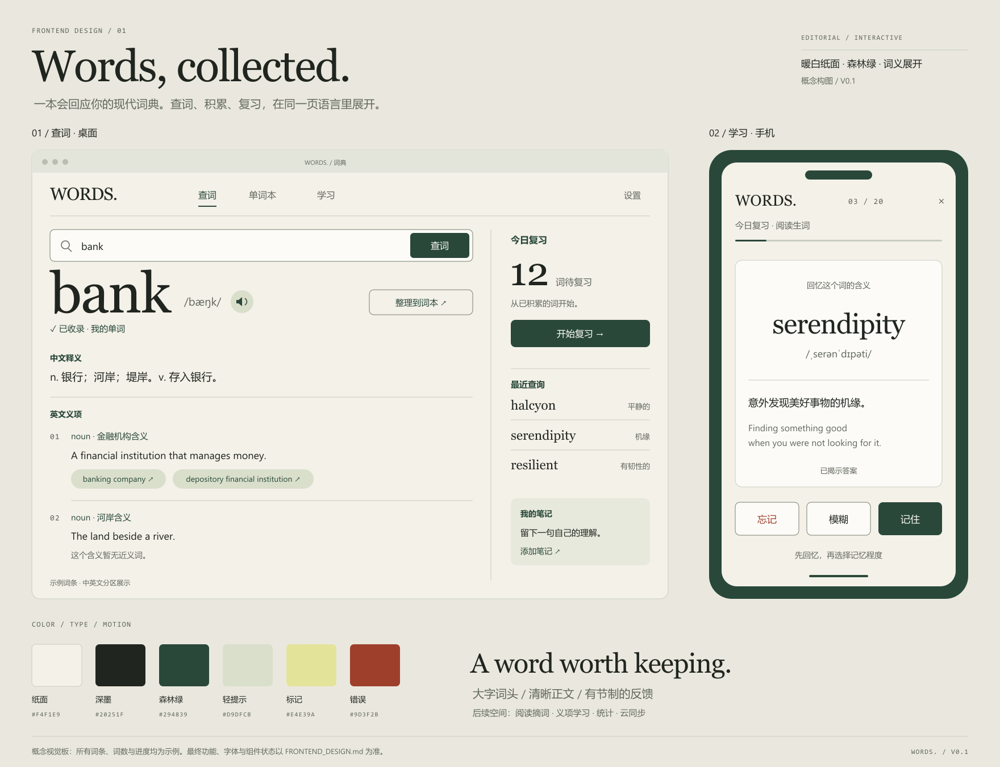

# 英文词典与单词本：前端视觉与交互设计

版本：0.1 · 开发前提案  
关联：[产品与技术设计](./DESIGN.md) · [GitHub 调研](./GITHUB_RESEARCH.md)

## 1. 设计方向

**把网站设计成一本会回应用户的现代词典。** 单词是页面的视觉主角，含义通过排版展开，查词、收录和复习通过连续的反馈连接起来。

采用编辑式排版：暖白纸面、深墨色文字、森林绿操作、少量柔和标记色。英文词头有鲜明字体性格，中文释义保持舒适阅读；大字、细线、留白与内容密度共同形成页面节奏。

工作名为 **WORDS.**，只用于本轮设计，后续可替换。界面主语言为中文；英语用于单词、释义和少量品牌表达，主要操作保持中文标注。

本文件独立规定视觉系统、页面结构、组件与扩展位置。功能行为继续遵循 DESIGN.md；其中原有第 10 节的概括性视觉建议以本文件为准。当前不开发或部署网站。



视觉板为概念构图，词条、词数和进度均为示例，不代表已实现功能或真实用户数据。词头使用 Georgia 近似最终拟采用的 Newsreader；布局与组件细节以本文规范为准。

## 2. Awwwards / FWA 对齐方式

Awwwards 已公开案例评分页列出 **Design 40%、Usability 30%、Creativity 20%、Content 10%**，可见 [Nike PLAYlab 的官方评分页](https://www.awwwards.com/sites/nike-playlab)。本项目据此同时要求艺术指导、操作清晰、独特交互与内容质量，而不是仅检查一张首页截图。

FWA 在本轮无法通过官方动态页面读取完整评审细则，因此不虚构评分权重。采用可追溯的获奖案例与创作者说明作为交互参考。以下“转化方式”是本项目的设计判断，不是奖项的官方要求，也不构成获奖承诺。

| 参考 | 已核查依据 | 转化为本项目的设计 |
| --- | --- | --- |
| [Editorial New / Locomotive](https://www.awwwards.com/editorial-new-variable-typeface-by-locomotive-wins-site-of-the-month-october.html) | Awwwards 官方文章确认其获得 2019 年 10 月 Site of the Month，介绍可变字体与交互展示 | 让英文词头承担品牌识别；围绕词义展开设计一个有辨识度的瞬间 |
| [Nike PLAYlab](https://www.awwwards.com/sites/nike-playlab) | Awwwards SOTD 页面；内容围绕用户参与组织 | 学习页面围绕“回忆 → 揭示 → 评分”组织，一屏明确一个主要动作 |
| [Choo Choo World / Lusion](https://lusion.co/projects/choo_choo_world/) | 创作者案例页明确链接 FWA SOTD，并说明其交互游戏目标；[FWA 案例入口](https://thefwa.com/cases/choo-choo-world) | 借鉴动作与反馈之间的连贯性，将记忆、进度与交互联系起来 |

案例研究基于官方或创作者公开说明，未完成其全部交互的现场体验。参考可以来自不同年份；不将上述作品描述为当下最新趋势。

### 对齐后的质量要求

| 维度 | 本项目的判断依据 |
| --- | --- |
| 视觉完整性 | 查词、词本、学习、空状态、设置与错误提示共享字体、颜色、网格与细节 |
| 可用性 | 搜索入口立即可见；按钮意义明确；键盘、触屏和读屏都能完成主流程 |
| 创意识别 | “词头 → 含义展开 → 收录回执”形成可记住的体验，与真实查询状态同步 |
| 内容 | 使用真实词典数据；双语边界、近义词来源与学习统计表述准确 |
| 实现质量 | 响应式、焦点管理、动效降级和性能一起验收，不依赖录制视频展示效果 |

## 3. 信息架构与扩展空间

### 当前导航

```text
全局：品牌 | 查词 | 单词本 | 学习 | 设置
查词：搜索 → 词条 → 中文释义 / 英文义项 / 笔记
单词本：全部词汇 / 分类词本 → 筛选与列表 → 整理
学习：设置本轮 → 翻卡 / 拼写 → 结果与继续
设置：偏好、备份恢复、数据来源
```

首次访问直接进入查词页。导航保持稳定位置；查词初始态可有简短品牌表达，结果态把空间交给词条。学习进行中使用聚焦布局，仅保留返回、进度和设置。

### 未来导航规则

- 顶部最多 5 个主要目的地。阅读摘词上线时可新增“阅读”，统计先放在“学习 → 总览”，避免主导航不断膨胀。
- 更多独立模块出现后，桌面增加“更多”菜单；移动端底部最多 4 个主要入口，额外入口统一进入“更多”。菜单按可用能力生成。
- 账号与同步放在右上角设置位置，后续用账号菜单承接；本地版本保持“设置”，不展示虚构头像或同步成功状态。
- 第一版保留查词右侧上下文区域、词条补充区域、词本工具栏和学习模式配置的结构接口。未启用区域不占空白、不显示待开发按钮。
- 新功能沿用同一 AppShell、内容容器与表单规范，优先增加局部模块；需要独立任务流程时才新增页面。

## 4. 视觉基础系统

### 4.1 色彩与语义

| Token | 色值 | 角色 |
| --- | --- | --- |
| `color.canvas` | `#F4F1E9` | 页面暖白底色 |
| `color.surface` | `#FCFBF7` | 输入、面板、抽屉与学习纸面 |
| `color.ink` | `#20251F` | 词头、正文与主要信息 |
| `color.muted` | `#62685D` | 元数据、时间、次要说明 |
| `color.brand` | `#294839` | 主要按钮、当前导航、强调文字 |
| `color.onBrand` | `#FCFBF7` | 深绿按钮文字 |
| `color.tint` | `#D9DFCB` | 词本封面、选中区域、轻提示背景 |
| `color.mark` | `#E4E39A` | 少量纸面标记，用于示例或关键短语 |
| `color.line` | `#C8CEC0` | 装饰性分隔线 |
| `color.controlBorder` | `#78816F` | 需要独立识别的输入边界与控件轮廓 |
| `color.danger` | `#9D3F2B` | 错误文本、删除动作；配合明确文字 |
| `color.focus` | `#3E5A8C` | 键盘焦点环 |

纯色配对已计算：正文/页面底 13.82:1，次要文字/页面底 5.09:1，主按钮文字/深绿底 9.75:1，错误文字/页面底 5.85:1。这些是当前 token 配对结果，实际半透明、图片背景及组件状态仍需再次检查。

浅分隔线只用于分区。输入框、复选框等靠轮廓识别的控件使用强边界。文字不使用低对比的“浅灰小字”制造视觉层级。

第一版优先完整浅色系统。主题 token 采用语义命名，为深色模式留出映射；深色模式在文本、状态、图表全部验证后再开放。

### 4.2 字体与中英文排版

英文词头拟用 [Newsreader](https://github.com/productiontype/Newsreader)，英文界面与释义拟用 [Inter](https://rsms.me/inter/)。中文采用系统字体，优先 PingFang SC、Microsoft YaHei，随后为系统 sans-serif。实现时核验字体文件许可、字形范围和包体，随网站保留许可证；Newsreader 加载失败回退 Georgia。

| 用途 | 桌面字号 / 行高 | 手机字号 / 行高 | 字重与限制 |
| --- | --- | --- | --- |
| 初始态品牌标题 | 80–112 / 1.02 | 44–56 / 1.08 | 衬线常规；最多 2 行；进入结果态后收起 |
| 单词词头 | 72–96 / 1.05 | 44–60 / 1.08 | 衬线常规；长词响应式缩小，仍超出则换行 |
| 页面标题 | 36–44 / 1.18 | 28–32 / 1.25 | 常规或中等；中文保持自然字距 |
| 英文释义 / 中文正文 | 17 / 1.65；中文 17 / 1.75 | 16 / 1.7 | 常规；阅读区域建议 45–72 个拉丁字符宽度 |
| 按钮 / 导航 | 15–16 / 1.4 | 15–16 / 1.4 | 中等 |
| 音标 / 元数据 | 14–16 / 1.5 | 14 / 1.5 | 音标使用支持 IPA 的系统后备字形 |
| 义项序号 / 进度 | 13–14 / 1.4 | 13–14 / 1.4 | 等宽或 tabular-nums，便于对齐 |

英文大标题可使用轻微负字距（-0.02em），中文正文不做负字距。界面主要正文不少于 16px；13–14px 只用于非关键元数据。连续数字使用等宽数字，进度更新时不跳动。

### 4.3 空间、网格与形状

- 间距梯度：4、8、12、16、24、32、48、64、96px；页面、组件和正文各有明确节奏。
- 桌面最大内容宽度 1280px，左右安全边距随视口为 32–64px；12 列，列间距 24px。
- 页面标题与工具栏间距 32–48px；释义内段落间距 12–16px，义项间距 24–32px。
- 按钮与输入圆角 8px，面板 12px，近义词标签 999px。大区块以网格与分隔线划分，小面板承接操作。
- 阴影只用于浮层、抽屉及焦点纸面；常态正文依靠对齐和边界表达层级。
- 图标使用一致的线性 SVG，16/20/24px 三档，线宽 1.5–2px。品牌图形可由字母、索引线和纸面标记构成。
- 暂不需要摄影素材。原生文字、SVG 与少量 CSS 形状即可完成第一版视觉；后续阅读内容有封面需求时再扩充媒体规范。

## 5. 页面设计

### 5.1 查词初始态

页面上方保持品牌和导航。主标题建议为 **“一个词，多种可能。”**；下方是一条显眼的搜索输入，标签“查找英文单词”，按钮“查词”。示例单词可点击发起查询，标注为示例。

标题和搜索区域占首屏上半部；已有用户在下方看到最近查询与今日复习。无历史时不填充虚假的图表或词数。标题区域高度保持克制，手机首屏即可触达搜索框和按钮。

### 5.2 查词结果态

桌面 12 列中，主内容占 8 列，右侧上下文占 4 列，间距 32px。词条正文宽度控制在约 720–800px；右栏约 280–336px。

```text
品牌 / 导航 / 设置
搜索输入 [bank                       查词]
──────────────────────────────────────────
bank            音标 / 发音    | 今日复习
已收录 · 词本归属             | 待复习数量 / 开始
中文释义汇总                  | 最近查询
──────────────────────────    | 个人笔记摘要
01 noun · 具体英文义项         |
   释义 → 该义项近义词 → 例句  |
02 noun · 另一含义             |
   释义 → 该义项近义词         |
补充释义 / 笔记 / 来源         |
```

中文释义汇总与英文义项使用明确标题，保留双语来源边界。义项序号只用于阅读定位，不暗示与中文序号一一对应。近义词放在各自英文义项内，数据缺失时保持区域诚实。

词头旁展示“已收录”和“整理到词本”。自动入本完成后显示轻量回执；按钮用于分类，避免出现与自动入本规则冲突的“加入收藏”主按钮。

长词、多义词和长例句为正常布局输入。英文义项首批展示前 6 条，超过时显示“展开其余 N 条”；展开内容仍属于正文流。来源位于词条尾部，用可阅读文字标注。

右栏作为后续扩展的位置：例句收藏、阅读出处、义项学习可在有数据时加入；模块按相关性排列，最多常驻 3 个，其余通过抽屉访问。

### 5.3 单词本页

使用“收藏索引”的排版表达积累感：上方是页面标题、真实词数与主要操作，下方是词本目录和词汇行。

桌面左侧目录宽 216–240px，右侧列表占余下空间。词本目录采用名称、数量和细索引标记；上方可有当前词本的小型封面，不给每个词汇行包一张大卡片。

词汇行默认高度约 80px，包含词头、中文简释、学习状态、查询时间与更多操作。悬停或焦点出现细背景变化；主要文字始终可见，更多菜单支持触屏。表头、排序和筛选固定在列表上方。

点击词头打开词条详情；整理归属、笔记等操作使用右侧抽屉，保留当前列表的筛选和滚动位置。批量选择时工具栏原地切换为“已选 N 词 / 整理 / 暂停 / 删除”，退出后恢复原工具栏。

手机使用词本选择器和单列词汇行；每行保留单词、简释与状态，时间放进详情。抽屉变为全屏面板，底部操作保持可见。

未来可在该页增加标签、来源与导入工具；通过筛选栏和工具菜单承接，词汇行的主阅读顺序保持稳定。

### 5.4 学习准备页

以“今天，留住几个词。”为页面标题，下面显示真实到期词数与新词数。配置区采用紧凑表单：词本、模式、数量、今日复习/自由练习；主要按钮为“开始本轮”。

模式选择采用分段控件，每个模式含名称和一句说明。未来听写、例句填空等模式通过能力清单加入；模式超过 4 个时改为列表选择面板。

### 5.5 学习进行中

整体进入聚焦模式，内容最大宽 880px。顶部保留“返回”、真实进度与选项；中央为纸面学习卡，底部是当前允许的操作。

词卡分为两个视觉层级：主提示区有大词头与音标；答案区以细线分开中文释义、英文含义与笔记。正面空间围绕回忆动作留白，背面采用自然滚动，长内容不会被固定高度裁切。

答案揭示前只有“查看答案”；揭示后显示“忘记 / 模糊 / 记住”。三个按钮面积相当，以文字区分，当前键盘快捷键可作为辅助提示。“记住”使用深绿强调，其他按钮保留足够视觉权重。

拼写页采用同一纸面布局，把主提示换成中文释义和输入框；输入法合成期间 Enter 不提交。反馈同时给出文字与正确答案。

手机操作区位于安全区域上方；软键盘打开时随可视区域调整，不遮住输入或答案。长背面内容可滚动，底部操作区使用不透明背景并留出足够底部 padding。

### 5.6 本轮结束页

用实际完成词数和本轮结果形成排版重点；副标题显示下一次到期信息。翻卡只展示自评分布，拼写展示首次提交正确率。主要操作“再学一轮”，次要操作“回到词本”。

完成反馈采用进度线收束或轻量标记动效。未来学习统计可从这里进入“学习总览”，保留当前结束流程。

## 6. 有辨识度的交互与动效

### 核心瞬间：词义展开与收录回执

查询成功后，大词头与释义同步进入阅读区域：词头轻微上移揭示，一条索引线伸向第一个义项，正文随后以短间隔显现。事务保存完成后，词本标记更新并出现“已记录到我的单词”。

效果与两种真实状态绑定：数据到达、保存完成。先到达的数据立即可读；保存失败显示具体反馈，不能因装饰动效提前宣布成功。动画不阻塞再次查询或分类。

再次查询同词使用简短内容过渡和“已更新查询记录”，不重复首次收录的完整表现。减少动画设置下，内容直接出现，回执保持文本。

### 动效规范

| 场景 | 默认时长 | 属性与表现 | 减少动画时 |
| --- | --- | --- | --- |
| 按钮、标签、导航反馈 | 100–140ms | 颜色、下划线，按压最多 1px 位移 | 仅颜色与焦点 |
| 面板与抽屉 | 180–240ms | opacity 与 translate，焦点进入面板 | 即时显示 |
| 页面切换 | 160–220ms | 内容区轻淡入，导航保持稳定 | 即时切换 |
| 首次词义展开 | 280–400ms，总长 ≤ 500ms | 词头位移 ≤ 12px，索引线、正文短显现 | 直接呈现 |
| 揭示答案 | 180–240ms | 答案区淡入与 6px 位移，纸面位置稳定 | 即时揭示 |
| 进度更新 | 160–220ms | 进度条长度插值，数字位置固定 | 立即更新 |
| 本轮结束 | 300–450ms，仅一次 | 线条收束或标记出现 | 静态完成状态 |

默认缓动 `cubic-bezier(0.22, 1, 0.36, 1)`，退出采用更快的 ease-in。大多数动画只使用 transform/opacity；滚动沿用原生机制。页面后台、元素离屏或设备降级时暂停非必要动画。

CSS 负责第一版动效。只有确需多元素时间线时才按需引入动画库；未来词义关系图使用可交互 SVG 和文本列表双重呈现。重型 3D、长预加载和滚动相机不属于第一版方案。

## 7. 组件系统与状态

| 组件 | 主要变体 / 状态 | 未来扩展位置 |
| --- | --- | --- |
| AppShell / Navigation | 默认、学习聚焦、移动端；当前页和焦点 | 新页面、账号与同步菜单 |
| SearchField | 初始、输入、加载、成功、无结果、下载错误 | 联想建议、词形建议 |
| WordHeader | 首次收录、已收录、暂停、部分语言缺失 | 义项掌握度、出处信息 |
| MeaningSection | 中文汇总、英文义项、来源补充、展开 | 已对齐的双语义项 |
| SynonymLink | 默认、hover、focus、查询中 | 近义词比较、关系图入口 |
| NotebookItem / WordRow | 空、选中、暂停、批量选择、缺内容 | 标签与来源过滤 |
| ContextPanel | 今日复习、最近查询、笔记 | 例句、阅读出处、AI 解释 |
| DetailDrawer | 开启、加载、编辑、保存失败 | 分类、来源、逐义项笔记 |
| StudyCard | 提示、揭示、长答案、提交中、已评分 | 听写、填空、义项卡片 |
| SessionProgress | 开始、进行、恢复、完成 | 分模式统计 |
| InlineNotice / Toast | 成功、提醒、失败、可撤销 | 同步与离线反馈 |
| EmptyState / ErrorState | 无历史、空词本、无到期、无词、断网、保存失败 | 云端冲突与恢复 |

图标按钮提供可访问名称；所有输入有可见标签。加载时保留控件原宽度，避免按钮跳动。需要重试的错误使用行内提示，toast 只承载短时反馈。

### 关键文案示例

| 状态 | 建议文案 / 动作 |
| --- | --- |
| 首次收录 | “已记录到我的单词” · 整理到词本 |
| 重复查询 | “已更新查询记录” |
| 没有找到 | “没有找到这个词。检查拼写后再试一次。” |
| 下载失败 | “词典暂时未加载成功。” · 重试 |
| 保存失败 | “词条已查到，但本次记录未保存。” · 再次保存 |
| 词本为空 | “从一个词开始。” · 去查词 |
| 今日无到期 | “今天的复习已完成。” · 学习新词 / 自由练习 |
| 恢复会话 | “上次学到第 N 个词。” · 继续 / 结束本轮 |
| 无近义词 | “这个含义暂无近义词。” |

## 8. 响应式与输入适配

| 视口 | 结构 | 主要调整 |
| --- | --- | --- |
| ≥ 1200px | 12 列，查词主区 + 右栏 | 完整词头、上下文与词本目录 |
| 768–1199px | 8 列，正文优先 | 右栏转折叠区域，词本目录可收起；标题下调 |
| < 768px | 4 列、单列内容，左右 20px | 简化导航与行字段，抽屉全屏，学习操作靠近底部 |
| ≤ 360px | 左右 16px | 词头按长度缩放或换行，评分按钮仍可触达 |

320px 宽、200% 文字放大、浏览器缩放和横屏都需要检查。断点响应的是内容是否放得下，而不是特定手机型号。长词、中文长笔记与 20+ 义项作为验收样本。

触摸区域目标至少 44×44px；紧凑标签可用内部留白扩大命中区域。悬停提供辅助反馈，主要功能同时支持点击与焦点。桌面快捷键在输入框、中文输入法和弹窗中有明确作用范围。

## 9. 可访问性与性能

以 [WCAG 2.2 AA](https://www.w3.org/WAI/WCAG22/quickref/) 为实现目标：正文对比度至少 4.5:1，大文本及需要识别的非文本边界至少 3:1；全程键盘可用、焦点可见、弹窗管理焦点，状态不只靠颜色传递。44px 命中区域是本项目的设计目标，不能将其误写成所有 AA 控件的统一要求。

结果区使用语义化标题和列表。页面主语言为 `zh-CN`，英文段落标记 `lang="en"`。查询和保存完成使用简短 polite 状态播报；答案隐藏时不提前进入可访问树，揭示后播报答案可查看。

全屏抽屉关闭后焦点返回触发按钮；进入页面后焦点定位到页面标题或主要任务。降低动画后，所有数据和状态变化仍有文字反馈。自定义单字符快捷键仅在学习任务区域有焦点时生效，并提供关闭选项。

### 项目性能预算

以下是本项目的开发目标，尚未实测，也不是奖项统一门槛。

| 项目 | 目标 / 口径 |
| --- | --- |
| Core Web Vitals | 发布后真实访问第 75 百分位 LCP ≤ 2.5s、INP ≤ 200ms、CLS ≤ 0.1，依据 [web.dev 官方定义](https://web.dev/articles/vitals) |
| 初始 JS | gzip 后 ≤ 180 KiB；学习和未来独立模块按路由拆分 |
| 初始 CSS | gzip 后 ≤ 30 KiB |
| 初始字体 | 必要 Latin 字体合计目标 ≤ 140 KiB；中文采用系统字体，按字形子集与实际测量调整 |
| 首次查询下载 | 含应用、必要字体和一份词典分片，压缩传输目标 ≤ 800 KiB |
| 本地操作反馈 | 控件视觉反馈目标 ≤ 100ms；存储成功仍以事务结果为准 |
| 动画与主线程 | 60Hz 设备尽量维持稳定帧率，避免连续 > 50ms 的主线程任务；低性能设备使用静态表现 |

Lighthouse 用于本地诊断，INP 的线上达标需要真实交互数据验证。字号预留、固定图标尺寸和稳定占位控制布局位移；字体使用 swap 或 optional 策略，后备字体度量尽量接近。

## 10. 后续功能的设计接口

| 未来功能 | 放置位置 | 复用组件 | 与第一版的兼容方式 |
| --- | --- | --- | --- |
| 阅读与摘词 | 新“阅读”页面；词条右栏显示出处 | SearchField、WordHeader、DetailDrawer | 阅读选词调用同一查询服务，回到原阅读位置 |
| 逐义项双语与独立学习 | 英文义项内的对齐译文及学习标记 | MeaningSection、StudyCard | 仅在提供可靠对齐关系时显示；继续支持中文汇总 |
| 例句收藏与填空 | 词条补充区；学习模式选择 | ContextPanel、ModePicker | 例句有来源和有效性状态，缺数据时不开放该题型 |
| 学习统计 | “学习 → 总览”与结束页入口 | Metric、Progress、EmptyState | 采用真实日志；区分自评、首答正确率和复习次数 |
| 账号与云同步 | 全局右上菜单；设置中的同步页 | SettingsMenu、InlineNotice | 显示未登录/同步中/冲突/离线；本地使用仍可继续 |
| AI 辅助解释 | 单个词的上下文抽屉 | ContextPanel、SourceLabel | 明确标注生成内容，不能覆盖词典原始释义 |
| 近义词比较 / 关系图 | 义项内“比较”展开区域 | SynonymLink、MeaningSection | 有文本列表替代；比较同一含义下的词 |
| 导入更多词库 / 来源标签 | 词本工具菜单和筛选栏 | ImportDialog、FilterBar | 来源与个人分类独立，现有筛选布局可扩展 |
| 深色模式 / PWA | 全局偏好与离线状态 | 语义 token、AppShell | 通过主题映射与能力开关加入，不改页面业务结构 |

### 前端模块边界

```text
AppShell
├─ Navigation：从已启用页面生成入口
├─ PageHeader：标题 / 文案 / 工具
├─ PrimaryContent：查词 / 词本 / 学习
├─ ContextRail：按场景挂载已可用模块
├─ DetailDrawer：细节与次要操作
└─ FeedbackLayer：保存、恢复、错误与撤销
```

组件通过 props / view model 接收数据，不直接依赖词典源字段或 IndexedDB。能力配置决定是否显示例句、音频、同步、独立义项学习等。资源缺失与能力未上线是不同状态：前者可提示，后者不生成入口。

单词展示模型为稳定 `wordId`、中文汇总、英文义项、来源及学习摘要；未来对齐译文是英文义项的可选字段，带来源与对齐状态。学习卡模型支持 `word` 与未来 `sense` 两类提示，模式注册表提供组件、输入方式和可用数据条件。

扩展约束：新模块沿用语义 token；每个页面保持一个明确的主要动作；第一版没有数据的模块不预留可见空卡片。大模块按路由或用户操作加载，新增动效与性能预算一起审核。

## 11. 前端落地规范

```css
:root {
  --color-canvas: #f4f1e9;
  --color-surface: #fcfbf7;
  --color-ink: #20251f;
  --color-muted: #62685d;
  --color-brand: #294839;
  --color-line: #c8cec0;
  --color-control-border: #78816f;
  --color-focus: #3e5a8c;
  --font-display: "Newsreader", Georgia, serif;
  --font-body: "Inter", -apple-system, BlinkMacSystemFont,
    "PingFang SC", "Microsoft YaHei", sans-serif;
  --content-max: 1280px;
  --radius-control: 8px;
  --radius-panel: 12px;
  --motion-fast: 120ms;
  --motion-base: 200ms;
  --motion-reveal: 360ms;
  --ease-out: cubic-bezier(0.22, 1, 0.36, 1);
}
```

第一版采用原有 React + TypeScript + Vite；CSS 变量与组件样式承接本规范。可变字号、网格和动效使用 token，避免各页面自行写不同色值。插图和图标以可维护 SVG 为主，语义化 HTML 承载所有核心内容。

后续开发前制作组件展示页，覆盖实际长内容、空状态、错误、焦点与减少动画；它用于内部验收，不进入产品导航。

## 12. 交付与验收

### 第一版设计交付

- 本文：视觉、页面、动效、组件、扩展接口与验收规范。
- [视觉设计板 PNG](./assets/frontend-visual-board.png) 与 [可编辑 SVG](./assets/frontend-visual-board.svg)：桌面查词和手机学习的方向示意。
- 后续实现按本文件与 DESIGN.md 共同验收；视觉板只展示构图，不替代产品逻辑。

### 验收矩阵

| 项目 | 验收方式 |
| --- | --- |
| 视觉一致性 | 三个主要页面、设置、空和错误状态使用同一 token 系统；没有未解释的字体、圆角和按钮变体 |
| 品牌识别 | 看词头、索引线、收录反馈即可辨认同一产品；创意体现在真实操作中 |
| 内容压力 | 用超长单词、至少 20 条义项、长中文笔记、无音标和无近义词数据检查 |
| 任务清晰 | 新用户无需说明即可完成查词、分类、开始学习；手机首屏能找到搜索入口 |
| 状态完整 | 下载、未找到、保存失败、提交中、刷新恢复、无到期均有独立且准确的反馈 |
| 键盘与读屏 | Tab 顺序合理；抽屉焦点可返回；答案未揭示时不泄露；状态正确播报 |
| 响应式 | 320、375、768、1024、1440px 及 200% 文本缩放下主流程可完成；无内容裁切 |
| 动效降级 | 开启减少动画后任务、状态和含义完整；动画期间仍可操作 |
| 性能 | 类型检查、生产构建、资源预算检查与浏览器测量；上线后再验真实 Web Vitals |
| 扩展演练 | 用虚拟 capability 配置加入阅读、义项学习或同步菜单，验证旧页面布局与流程稳定；不将测试入口发布 |

当前已完成设计规范与静态视觉板。网页组件实现、真实交互验证、响应式运行测试与上线性能测量留在开发阶段，不能将静态设计图视为已完成这些验证。
