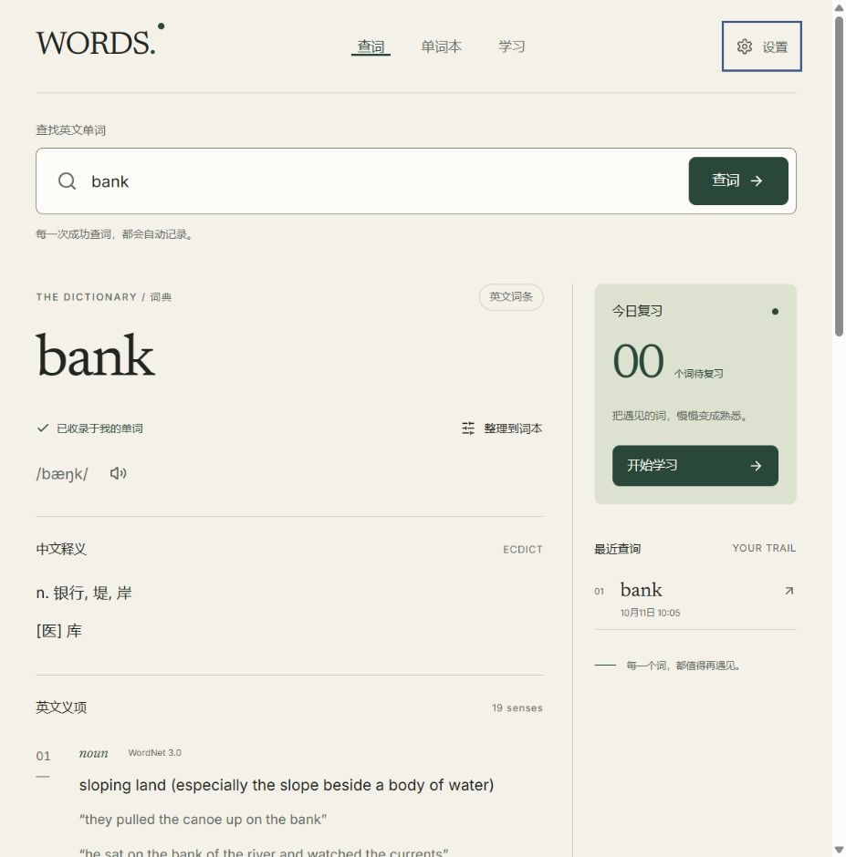

# 第一版实施与验证记录

## 2026-10-12 个人云同步更新

已新增 Cloudflare Worker、D1 数据库、仅允许本人账号的 GitHub OAuth 登录，以及基于记录版本的增量同步。个人单词、词本归属、笔记、复习日程、查询与复习事件、学习偏好跨设备共享；词典分片与正在进行的练习会话仍在本机使用。旧 IndexedDB 数据通过版本 2 迁移保留；换网址需导出并导入一次备份。

当前 [生产网站](https://words-notebook.words-notebook.workers.dev) 已完成真实 GitHub 登录、自动同步状态和 interaction 查询上传验证。密钥保存在 Cloudflare Secrets，D1 会话只保存随机 Cookie 的摘要，公开仓库没有登录凭据或个人词本数据。

55 项测试全部通过，覆盖两台独立数据库合并、冲突笔记、并发复习、删除与重新收录、分页、丢失确认、上传期间编辑、版本 1 数据迁移、接口鉴权与 Origin 校验。前端与 Worker 类型检查、生产构建及 512 个词典分片预算校验通过。当前 gzip 初始 JS 120.88 KiB、CSS 9.11 KiB、首次查询保守估算 385.15 KiB。真实手机与电脑间的同时操作尚待使用验收；完整离线启动和真实 Web Vitals 仍未验证。

维护说明见 [CLOUDFLARE.md](CLOUDFLARE.md)。下文为 2026-10-11 第一版的历史验证记录，未部署、无账号和无云同步的描述仅适用于当时版本。

日期：2026-10-11（北京时间）。依据 DESIGN.md、FRONTEND_DESIGN.md 与 GITHUB_RESEARCH.md 实现；原文件保留为设计阶段快照，当前代码进度以本文为准。

## 实现结果

已从只有设计文件的工作区建立 React 19 + TypeScript + Vite 项目，独立实现查词、词本与学习三个页面。没有复制调研候选项目的代码，没有注册账号、接入云同步或部署。

| 模块 | 已实现行为 |
| --- | --- |
| 静态词典 | 完整 ECDICT + WordNet 3.0 转换，512 个分片，固定来源摘要、版本、许可、覆盖报告；相对 BASE_URL 加载、分片结构与 SHA-256 校验 |
| 查词 | 规范化、明确提交才记事件、同词去重、成功事务收录、中文汇总 / 英文义项分开、按义项近义词、例句、缺项与错误提示、保存失败重试 |
| 缓存与历史 | 已保存词条可本地读取；重复提交更新历史；刷新和返回查询 URL 只恢复展示；清除历史保留词汇与进度 |
| 词本 | 多归属、名称唯一、创建 / 重命名 / 删除分类、笔记、词或笔记搜索、筛选排序、批量整理 / 暂停 / 恢复、删除词与 12 秒撤销 |
| 复习 | 1 / 3 / 7 / 14 / 30 天阶梯，忘记 10 分钟，模糊明天，熟悉阶段仍安排复习，按学习时区计算当地日历天 |
| 学习 | 翻卡、反向回忆、拼写、今日 / 自由模式、每轮最多 20 个不同词、补新词最多 10 个、固定队列、重练一次不重复调度、会话恢复与真实结果 |
| 一致性 | 查询与评分事务去重，进度事务读取最新版本，多标签页数据通知；已有会话时拒绝另开轮；删除 / 暂停 / 导入暂停状态会修剪进行中队列 |
| 备份 | JSON 导出、20 MiB 验证、预览后确认合并、关联验证、事件去重、历史重算、较新进度优先、笔记保留与分类重映射、写入失败回滚 |
| 前端 | 纸面与森林绿 token、Newsreader / Inter、手机布局、原生 dialog、可见焦点、状态文本、学习快捷键、IME 防误提交、减少动画 |

数据详情见 [DICTIONARY_REPORT.md](DICTIONARY_REPORT.md)。共 772,845 条词条，双语内容 231,610 条（29.97%）；30 个常用词的字段与样本核查通过。字段存在率不等于释义质量或所有词义完备性。WordNet 使用固定提交的 NLTK 原版分发包，未声称与无法下载的 Princeton tar.gz 逐字节比对。

## 自动化验证

`npm.cmd run typecheck`、`npm.cmd test`、`npm.cmd run build` 均通过。32 个测试分布在 3 个测试文件中：

- 词典：真实常用词与 bank 含义分离、CSV/WordNet 输出、规范化与精确短语、不猜词形、BASE_URL、缓存、查无词 / 网络 / 数据错误、摘要篡改、许可摘要。
- 存储：查询事务去重、重复搜索不覆盖笔记/暂停/进度、分类规则、删除撤销、清历史、空库备份恢复、重复合并、笔记冲突、分类 ID 重映射、更新更晚的进度、不合法关联与大小拒绝、导入回滚、删除后的历史日志保留。
- 学习：阶段与间隔、模糊新词、忘记 10 分钟、跨夏令时与上海跨午夜日期、到期优先/新词上限/去重/暂停、重复评分、刷新重开、自由练习、重练不改日程、拼写资格、并发开轮、读取最新进度、导入暂停后的队列一致性。

Vitest 在 Windows 沙箱使用线程池，`npm test` 已固定 `--pool=threads`，避免临时 SSR 文件在独立进程中的沙箱读取问题。Vite 配置 `preserveSymlinks`，处理本环境原生 realpath 访问限制。

安装时发现的旧测试和 CSV 解析器依赖公告已通过更新修复；`npm audit` 与生产依赖审计均返回 0 个已知漏洞。这是本次工具审计结果，不是永久安全保证。

## 浏览器验证

通过 Codex 浏览器操作真实开发服务与生产静态预览；生产页面没有捕获到 error / warn 日志。

| 实际操作 | 观测结果 |
| --- | --- |
| bank、Bank 与首尾空格查询 | 词本保留一个 bank，成功操作更新同一查询聚合 |
| bank 多义展示 | 中文汇总与 19 个英文义项（18 个 WordNet + ECDICT 补充）分开；河岸与金融机构的例句、同义成员归属不同义项 |
| 新建“阅读生词”，整理 bank，保存笔记 | 分类计数更新，进入词本与学习背面仍可读到笔记 |
| 开始翻卡，刷新，继续本轮 | 恢复原队列位置；揭示前可访问树没有中文答案，揭示后可查看中英文与笔记 |
| 记住评分与无到期状态 | 下一次到期为上海当地次日同一时间；本轮完成后可选自由练习 |
| 自由拼写 bnak → bank 重练 | 显示错误与正确拼写；重练不更改计划；首次正确率保持 0 / 1，日志显示共 2 次练习 |
| 学习区 Space / 2 | 先揭示答案，再提交“模糊”评分；状态保存 |
| 生产预览导出、刷新、预览并合并同一备份、再次导出 | 两份导出文件均为 1 个个人词、1 个查询事件、查询计数 1；刷新与重复导入未累加事件 |
| 窄屏与长学习答案 | 320、375、768、1024、1440px 下内容宽度未超过可用宽度；375px 词本、320px 多义词查词经截图检查 |
| 内部检查页长内容与焦点 | 真实 light 全部 48 条义项和 900 字测试笔记在 320 / 375px 无横向溢出；手机操作区吸底且不透明；弹窗 Tab 进入输入，Escape 关闭后焦点返回开启按钮 |

已修复检查中发现的窄屏导航换行、320px 非覆盖滚动条导致的水平溢出、旧词编辑状态跨异步查询污染新词、旧保存重试污染新回执、存储已提交后读取失败被误报未保存、StrictMode 与卸载时弹窗焦点返回失效等问题。

开发服务的 `component-showcase.html` 提供可重复的内部内容与控件检查；真实词典只读，模拟状态和笔记清楚标记为测试数据，无数据库写入，不进入默认生产构建。

真实截图：

## 资源预算

`node scripts/check-budgets.mjs` 校验生产资源、分片数量、许可存在和设计预算，gzip level 9 实测：

| 指标 | 本次结果 | 设计上限 |
| --- | ---: | ---: |
| 初始 JS | 114.18 KiB | 180 KiB |
| 所有路由 JS 合计 | 130.13 KiB | 初始预算不包含懒加载路由 |
| 所有 CSS 合计 | 8.92 KiB | 30 KiB |
| 全部 WOFF2 字体 | 92.54 KiB | 140 KiB |
| 最大词典分片 | 128.54 KiB | 300 KiB |
| 首次查询保守估算（初始 JS + 全 CSS + 全 WOFF2 + manifest + 最大分片） | 378.11 KiB | 800 KiB |

以上按托管服务器开启 gzip 压缩计算，包含未必首屏会下载的全部字体与 CSS。不是浏览器实际网络传输测量，也不代表 LCP / INP / CLS 达标。整库 JSON 约 325.40 MiB（gzip 合计约 57.82 MiB），仅按需下载分片。

## 后续验证与明确边界

- 未部署，未测正式域名、托管压缩、真实 Web Vitals 或 Lighthouse；浏览器数据按开发/预览/正式域名隔离。
- 已做键盘、dialog 与答案可访问树检查，尚未完成独立读屏软件、200% 文字缩放、所有长词/长笔记、真实手机软键盘与全量 WCAG 2.2 AA 审核。
- 数据异常、网络失败、重复提交和跨时区日期主要由固定自动化测试验证；尚未模拟真实浏览器配额耗尽和全部跨标签 UI 竞争情况。
- 备份无效时整体拒绝，预览中的无效数量为 0；未实现“跳过坏记录后部分导入”。会话不从备份导入。
- 没有 Service Worker、完整离线启动、在线词典增强、账号、云同步、深色模式和后续阅读功能。已打开应用的已保存词可继续本地学习。

下一阶段按 DESIGN.md 第 11 节处理部署与正式域名验收，并补齐上述界面压力/读屏与线上性能验证。
